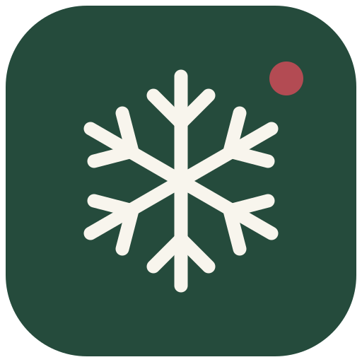
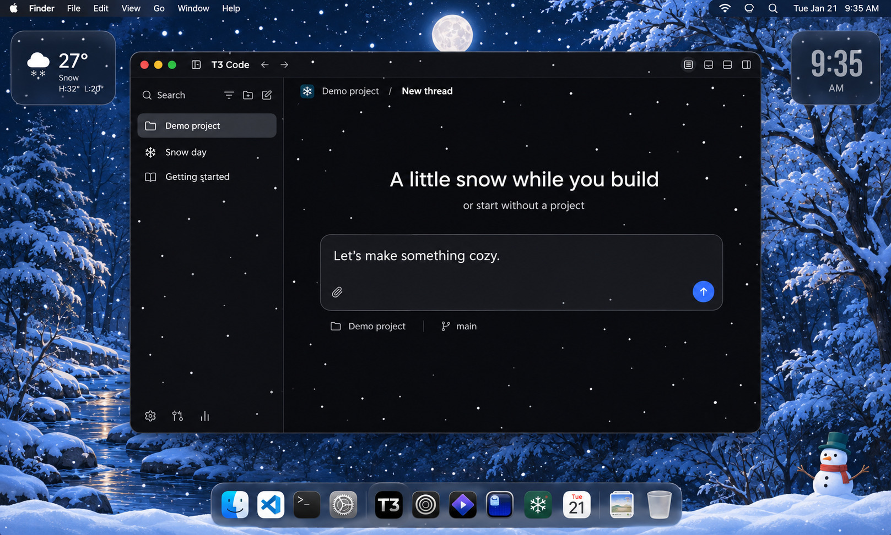

<p align="center"></p>

# nightfall

a little snow on your desktop. a tiny snowman. a very good excuse to stay in.

Rust + Tauri, with a native GTK overlay on Linux and desktop windows on macOS.



*Generated, sanitized desktop illustration. Fictional T3 Code content.*

### install

Linux x86_64, Apple Silicon Mac, or Intel Mac:

```sh
curl -fsSL https://raw.githubusercontent.com/romeirofernandes/nightfall/main/distribution/install.sh -o /tmp/nightfall-install.sh
bash /tmp/nightfall-install.sh
```

Add `~/.local/bin` to your PATH, then:

```sh
nightfall          # open settings
nightfall disable # clear the desktop, keep settings open
nightfall enable  # bring back the snow, or start the app
nightfall status
nightfall quit    # stop the app
```

Linux needs GTK 3, WebKitGTK 4.1, gtk-layer-shell and AppIndicator.
Hyprland is the primary Linux target, including snow on window ledges.
Other Wayland compositors need the layer-shell protocol; window ledges are
Hyprland-specific. GNOME, KDE and X11 overlays are not supported.
Reconnect a monitor? Restart Nightfall to create its overlay.

On Mac, open `~/Applications/Nightfall.app` once and approve it in
Privacy & Security if Gatekeeper asks. Downloads are ad-hoc signed, not
Apple-notarized. Keep Gatekeeper enabled.

The [Homebrew install](distribution/HOMEBREW-RECOVERY.md) remains available.
[Platform dependencies, source builds and uninstall](distribution/README.md) ·
[downloads](https://github.com/romeirofernandes/nightfall/releases/latest)
