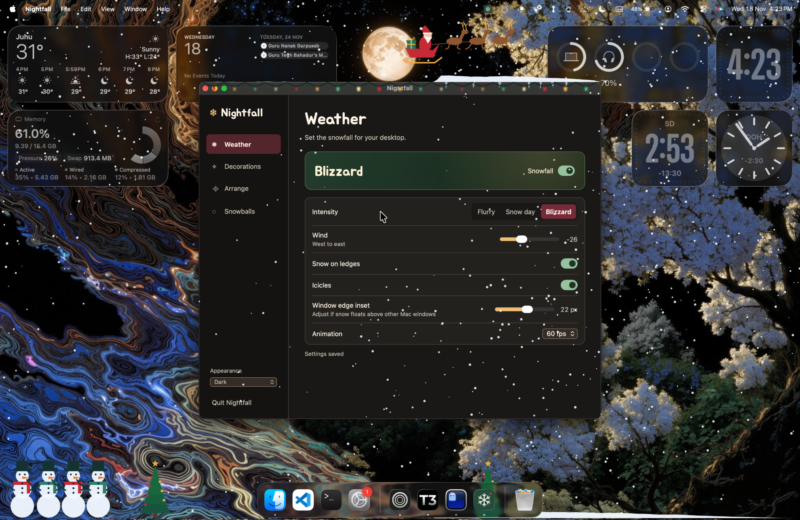

# nightfall

i wanted snow on my desktop without paying for it, so we made Nightfall. it's a free alternative to [Snowfall for Mac](https://snowfallmac.com/) for macOS, Linux, and Windows.



### get it on your Mac

```sh
brew tap --custom-remote romeirofernandes/nightfall https://github.com/romeirofernandes/nightfall
brew install --cask romeirofernandes/nightfall/nightfall
```

### get it on Linux

```sh
curl -fsSL https://raw.githubusercontent.com/romeirofernandes/nightfall/main/distribution/install.sh -o /tmp/nightfall-install.sh
bash /tmp/nightfall-install.sh
```

Snow works on Hyprland, other Wayland compositors with layer-shell, and composited X11. See the [Linux dependencies](distribution/README.md#linux).

### download Nightfall for Windows (x64)

[Find the Windows download on GitHub Releases](https://github.com/romeirofernandes/nightfall/releases/latest) and look for `Nightfall-<version>-windows-x64.zip` under **Assets**. The ZIP will be available with the first tagged Windows release.

1. Extract the ZIP into a folder.
2. Double-click `nightfall-renderer.exe` to open Nightfall.
3. For terminal controls, open PowerShell in that folder and run `.\nightfall.exe`.

**using PowerShell?** Save [download-windows.ps1](distribution/download-windows.ps1) and run this from the folder where you saved it.

```powershell
.\download-windows.ps1
```

The script checks the ZIP against the release checksum and extracts it into a versioned folder under Downloads.

See the [Windows setup details](distribution/README.md#windows) for the WebView2 requirement.

open **Nightfall** and pick your weather. hit **Arrange** to move the snowmen, trees, and gifts around. if the snowballs get out of hand, press **Esc**.

rather stay in the terminal? run `nightfall`. [downloads](https://github.com/romeirofernandes/nightfall/releases/latest)

enjoy the snow, mate. ❄
